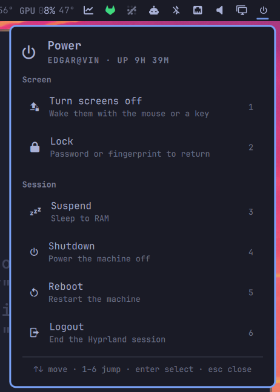

# Power Button — Omarchy bar widget

A power button for the bar. One click opens a session menu; every action is one
keystroke away, and the three that lose unsaved work ask first.



Every action runs Omarchy's own session script — `omarchy-system-lock`,
`omarchy system shutdown`, `omarchy system reboot`, `omarchy system logout`,
`systemctl suspend` — rather than reimplementing what they do. Whatever those
grow later, this widget inherits. Only **Turn screens off** has no Omarchy
equivalent, so it dispatches to Hyprland directly.

## Install

```sh
omarchy plugin add https://github.com/edgarsilva/omarchy-power-button.git --enable
```

Then place it where you want it and restart the shell:

```sh
omarchy bar move io.github.edgarsilva.power-button --section right
omarchy restart shell
```

Nothing to configure — it finds the sleep states this machine actually supports
on its own.

## Usage

- **Left click** — opens the menu.
- **Right click** — runs one action straight away without opening the menu, and
  without the confirmation prompt. Lock by default; `None` disables it.
- **Hover** — names the right-click action, so a stray right click is never a
  surprise.

In the menu:

| Key | Does |
|---|---|
| `↑` `↓`, `j` `k` | Move the cursor |
| `1`–`9` | Jump straight to that row and run it |
| `enter`, `space` | Run the highlighted action |
| `esc` | Close — or, with a prompt up, back out of the prompt to the menu |
| `tab` | Move to the next bar popup |

Numbering follows the rows actually on screen, so it stays dense whatever you
enable, and the footer names the range that exists rather than a fixed `1–9`.

### Why numbers and not letters

The shell's shared `PanelKeyCatcher` already claims `h` `j` `k` `l` for cursor
movement and `x` for delete before a panel sees them, which takes the natural
first letters of **L**ock and **S**hutdown off the table. Half-letter,
half-number accelerators would be worse than either, so the menu is numbered
throughout.

## The actions

| | Runs | Notes |
|---|---|---|
| Turn screens off | `hl.dsp.dpms` | See [below](#turning-the-screens-off) — the only one with no `omarchy-*` script |
| Lock | `omarchy-system-lock` | Locks the session, resets the keyboard layout, locks 1Password, stops the screensaver. It does **not** turn the displays off |
| Suspend | `systemctl suspend` | Hidden while the `suspend-off` toggle is set |
| Hibernate | `systemctl hibernate` | Only where `omarchy-hibernation-available` succeeds |
| Shutdown | `omarchy system shutdown` | Confirms first |
| Reboot | `omarchy system reboot` | Confirms first |
| Logout | `omarchy system logout` | Confirms first |

Actions run detached, on purpose: Logout and Shutdown tear down the session the
shell itself lives in, and a tracked subprocess would be killed mid-flight by
the very thing it started.

### Turning the screens off

Hyprland 0.56 moved its dispatchers to Lua. The `hyprctl dispatch dpms off` that
every Waybar and wlogout config still carries now exits **7** and does nothing at
all — silently, if you redirect stderr. The widget uses the current form and
falls back to the legacy one, the same chain `omarchy-launch-screensaver` uses:

```sh
hyprctl dispatch 'hl.dsp.dpms({ action = "disable" })' || hyprctl dispatch dpms off
```

The **delay** matters as much as the command. Omarchy's `input.lua` ships with
`key_press_enables_dpms` and `mouse_move_enables_dpms` set, so the mouse-button
release that follows your click — or any nudge of the mouse — wakes the displays
straight back up. Dispatching 400 ms late lets the release land first. Raise
`screenOffDelayMs` if your screens still wake instantly; set it to `0` to
dispatch immediately.

Check what actually happened with `hyprctl monitors -j | jq '.[].dpmsStatus'` —
`false` is off.

### Suspend and Hibernate

Both rows are conditional, so the menu never offers a sleep state the machine
cannot enter. Availability is re-probed on every open, so neither needs a shell
restart after you change it.

- **Suspend** disappears while Omarchy's `suspend-off` toggle is set
  (`omarchy toggle suspend`), matching what `omarchy-menu` does.
- **Hibernate** appears only where `omarchy-hibernation-available` succeeds. It
  needs swap at least the size of RAM, which `omarchy-hibernation-setup`
  configures — so it is there on a laptop set up for it and absent on a desktop
  that never was.

Suspend sleeps to RAM: instant resume, but it keeps drawing power and loses the
session if the battery goes flat. Hibernate writes RAM out to swap and powers
off completely: nothing is lost, resume is slower. Both are in the **Actions**
setting too, so either can be hidden on a machine that does support it.

## Confirmation

Shutdown, Reboot, and Logout ask before running. `←` `→` or `tab` swap buttons,
`enter` commits, `esc` backs out to the menu rather than closing the panel — a
half-made decision should not need reopening.

`confirm` controls the rule: `Never`, `Destructive actions` (the default —
those three), or `Every action`. The right-click quick action never prompts,
whatever this is set to; that is the point of it.

Destructive rows only warm to the theme's urgent colour once the cursor is on
them. A menu that is red at rest reads as an error state rather than as a
consequence.

## Settings

Set per bar entry in `~/.config/omarchy/shell.json`, or through the shell's
widget settings UI. They apply on save.

```json
{
  "id": "io.github.edgarsilva.power-button",
  "confirm": "Every action",
  "rightClickAction": "None",
  "showDescriptions": false
}
```

| Key | Default | Meaning |
|---|---|---|
| `items` | *(all)* | Which actions the menu offers, by label. Empty means all the ones this machine supports |
| `confirm` | `Destructive actions` | `Never`, `Destructive actions`, or `Every action` |
| `rightClickAction` | `Lock` | Runs on right click without the menu or a prompt. `None` disables it |
| `icon` | `󰐥` | Nerd Font glyph shown in the bar |
| `showGroupHeaders` | `true` | The **Screen** and **Session** headers |
| `showDescriptions` | `true` | The second line under each action. Off gives a compact menu |
| `showNumbers` | `true` | The number hint at the right of each row |
| `screenOffCommand` | *(empty)* | Override the DPMS command. Empty uses the built-in chain |
| `screenOffDelayMs` | `400` | Delay before dispatching it, 0–5000 |

Colours are not configurable on purpose. Rows draw in the theme's foreground and
destructive ones mix toward its urgent colour, so the menu stays coherent across
every Omarchy theme.

## IPC

The command table the panel renders is scriptable, so a Hyprland bind can reuse
it instead of duplicating the commands in `bindings.conf`:

```sh
omarchy-shell io.github.edgarsilva.power-button toggle      # open/close the menu
omarchy-shell io.github.edgarsilva.power-button list        # ids of the enabled actions
omarchy-shell io.github.edgarsilva.power-button run lock    # run one, no menu, no prompt
```

`run` takes any id `list` prints: `screens-off`, `lock`, `suspend`,
`hibernate`, `shutdown`, `reboot`, `logout`. It refuses an action this machine
does not support rather than failing silently, and it answers `ok` when it
starts one.

```lua
o.bind("SUPER + CTRL + ALT + P", "Power menu",
  "omarchy-shell io.github.edgarsilva.power-button toggle")
```

## Requirements

- A Nerd Font for the glyphs, which Omarchy already ships
- Omarchy's `omarchy-system-*` scripts, which it also already ships
- `hyprctl`, for **Turn screens off** only

No pip packages, no daemon, no elevated privileges. The widget writes nothing:
it reads `/proc/uptime`, asks two `omarchy-*` helpers what this machine
supports, and shells out only when you pick something.

## Development

The repo is the source of truth; the shell loads a plain copy from
`~/.config/omarchy/plugins/<id>/`. Sync and reload after an edit:

```sh
rsync -a --delete --exclude .git ./ ~/.config/omarchy/plugins/io.github.edgarsilva.power-button/
omarchy restart shell
```

`omarchy restart shell` rather than a hot reload: edited plugin QML is often
still served from the old instance until the shell process restarts, and
`omarchy-shell shell rescanPlugins` will report a reload that did not visibly
happen.

Symlinking the plugin directory at the workspace does not work —
`omarchy plugin validate` refuses a plugin folder that is itself a symlink.

Validate before publishing:

```sh
omarchy plugin validate .
mkdir -p /tmp/qsimports/qs
ln -s /usr/share/omarchy/shell/Ui /tmp/qsimports/qs/Ui
ln -s /usr/share/omarchy/shell/Commons /tmp/qsimports/qs/Commons
qmllint -I /tmp/qsimports -I /usr/lib/qt6/qml Panel.qml Service.qml
```

That reports no errors. The remaining warnings are `unqualified` for `root.`
read inside a `Component` delegate, `missing-property` for `Style.*` and `bar.*`
through their `QtObject`s, and one `signal-handler-parameters` for
`Process.onExited` — all artifacts of how qmllint resolves component scopes and
Quickshell's types, and the shell's own widgets produce the same class.

The capability probe runs standalone, which is the fastest way to see what the
widget will offer on a given machine:

```sh
omarchy-hibernation-available && echo "hibernate available"
omarchy-toggle-enabled suspend-off && echo "suspend hidden"
```

Testing the keyboard path needs the open, the key, and the screenshot in one
command — the panel dismisses itself between separate invocations, which makes
a split test read as a failure that never happened:

```sh
omarchy-shell io.github.edgarsilva.power-button open; sleep 1; wtype "1"
```

## Removal

```sh
omarchy plugin remove io.github.edgarsilva.power-button
```

That drops it from the bar and deletes the plugin. It keeps no state and writes
no files of its own, so there is nothing else to clean up.

## License

MIT — see [LICENSE](LICENSE).
